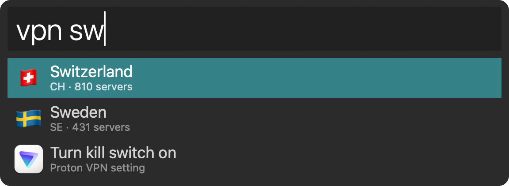

# Alfred Proton VPN

[](https://github.com/stevelacey/alfred-proton-vpn/releases)
[](https://github.com/stevelacey/alfred-proton-vpn/actions/workflows/ci.yml?query=branch:main)
[](https://github.com/stevelacey/alfred-proton-vpn/releases)
[](LICENSE.md)

An Alfred workflow for Proton VPN: connect to a country, server or mode, disconnect and change settings,
all from the `vpn` keyword. It uses the [Proton VPN CLI (forked for macOS)](https://github.com/stevelacey/proton-vpn-cli-macos).



## Better together

- **[Proton VPN CLI](https://github.com/stevelacey/proton-vpn-cli-macos)**, forked for macOS: `vpn` and `protonvpn` in your terminal
- **[Proton VPN Menu Bar](https://github.com/stevelacey/proton-vpn-menubar)**: status, countries and settings in your menu bar

They all drive the same connection: connect from one and the others keep up. Use them instead of
Proton's Mac app, not alongside it, since it runs its own VPN connection that these can't see or control.

## Features

- 🌍 Countries by name, code or alias (`vpn swiss`, `vpn uk`), with flags
- ⚡ Fastest, random and specific servers (`vpn fastest`, `vpn random japan`, `vpn CH#871`)
- 🔒 Secure Core, P2P and Tor, anywhere or in a country (`vpn sc japan`, `vpn p2p nl`, `vpn tor swiss`)
- ⚙️ NetShield, kill switch and port forwarding toggles, and DNS (`vpn kill`, `vpn dns cloudflare`)
- 🔌 Disconnect and status (`vpn disconnect`, `vpn`)

## Install

```sh
brew install stevelacey/tap/proton-vpn-cli-macos
vpn setup
protonvpn signin <username>
```

Then [download the workflow](https://github.com/stevelacey/alfred-proton-vpn/releases/latest) and open it.

Requires Alfred with the Powerpack.

## Development

```sh
./bundle --install   # builds Proton VPN.alfredworkflow and opens it in Alfred
./install            # copies src/ over the installed copy
```

## License

MIT
